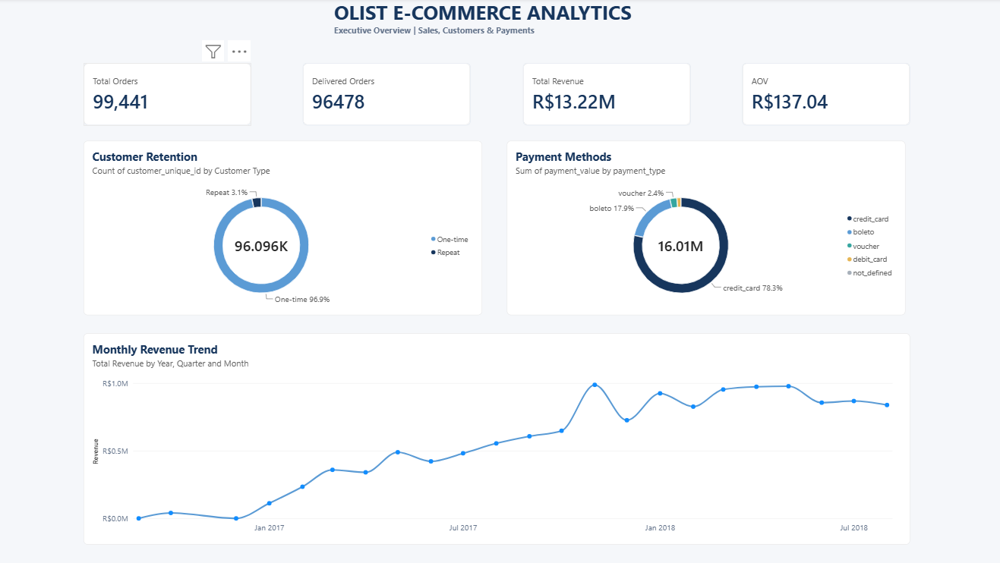

# Olist E-commerce Data Analysis | Python, SQL & Power BI

## Project Overview

This project analyzes the Olist Brazilian e-commerce dataset to understand sales performance, customer retention, payment behavior, product categories, seller performance, and delivery-related customer satisfaction.

Using Python, SQL, and Power BI, I cleaned and analyzed data across multiple tables, developed business KPIs, and created visualizations to identify actionable business insights and improvement opportunities.

## Business Objectives

- Analyze order volume, delivered revenue, and average order value.
- Identify top-performing product categories and sellers.
- Understand customer retention and repeat-purchase behavior.
- Evaluate payment methods and installment patterns.
- Examine customer distribution across Brazilian states.
- Investigate the relationship between delivery performance and customer satisfaction.
- Identify opportunities to improve seller shipping performance and customer experience.

## Tools & Technologies

- **Python:** Pandas, NumPy, Matplotlib
- **SQL:** PostgreSQL, pgAdmin 4
- **Power BI:** DAX, data modeling, KPI cards, interactive charts and dashboards
- **Jupyter Notebook:** Data exploration, cleaning, and analysis

## Project Workflow

1. **Data Understanding:** Explored datasets, inspected schemas, checked data types, and assessed data quality.
2. **Data Cleaning:** Handled missing values, corrected data types, and prepared datasets for analysis.
3. **Exploratory Data Analysis:** Examined sales, customers, products, payments, reviews, and delivery performance using Python.
4. **SQL Analysis:** Used JOINs, CTEs, subqueries, CASE statements, aggregations, GROUP BY, and window functions to answer business questions.
5. **Power BI Dashboard:** Built KPIs and visualizations to communicate revenue trends, customer behavior, payment patterns, geography, seller performance, and customer satisfaction.

## Key Business Insights

- **Delivered Product Revenue:** Generated approximately **R$13.22 million** in delivered product revenue, excluding freight.
- **Average Order Value:** Recorded an average of approximately **R$137.04 per delivered order**.
- **Customer Retention:** Only **3.12% of unique customers** placed repeat orders during the observed dataset period, highlighting customer retention as an improvement opportunity.
- **Customer Satisfaction:** Orders delivered late had an average review score of **2.57**, compared with **4.29** for orders delivered early or on time.
- **Product Performance:** Beauty & Health was the leading product category, contributing approximately **9.33% of delivered product revenue**. The top five categories contributed approximately **39.83%**.
- **Payment Behavior:** Credit cards accounted for approximately **78.34% of total payment value**.
- **Customer Geography:** São Paulo accounted for approximately **41.9% of unique customers**, making it the largest customer market in the dataset.
- **Seller Performance:** Shipping analysis identified differences in on-time shipping performance among sellers, highlighting opportunities to improve fulfillment processes.

*Note: These findings describe the observed dataset and do not establish causation. Repeat-purchase behavior is measured only within the available observation period.*

## Power BI Dashboard

The dashboard includes:


(olist_dashboard2.png)

- KPI cards for total orders, delivered orders, delivered product revenue, and average order value.
- Monthly revenue trend analysis.
- Top product categories by delivered revenue.
- Payment method distribution.
- Repeat versus one-time customer analysis.
- Customer review score distribution.
- Delivery performance versus average review score.
- Customer share by state and customer share versus revenue share.
- Top sellers by delivered revenue.

## SQL Skills Demonstrated

- Data retrieval and filtering using SELECT and WHERE
- Aggregations using COUNT, SUM, and AVG
- GROUP BY and ORDER BY
- Multi-table analysis using JOINs
- Conditional logic using CASE WHEN
- Common Table Expressions (CTEs)
- Subqueries
- Window functions for percentage shares and rankings
- Date-based analysis using PostgreSQL date functions


## Repository Structure

```text
ecommerce_data_analysis/
├── notebook/
│   ├── 01_data_understanding.ipynb
│   ├── 02_data_cleaning.ipynb
│   └── 03_data_analysis.ipynb
├── cleaned_data/
│   └── Cleaned CSV datasets
├── sql/
│   └── olist_analysis_queries.sql
├── powerbi/
│   └── olist_ecommerce_dashboard.pbix
└── README.md
```


## How to Explore the Project

1. Review the notebooks in sequence to understand the data exploration, cleaning, and analysis process.
2. Open the SQL scripts in PostgreSQL to review the business queries.
3. Open the Power BI report in Power BI Desktop to explore the dashboard and its findings.

## Conclusion

This project demonstrates an end-to-end data analysis workflow, from data preparation and exploratory analysis to SQL-based business analysis and Power BI reporting. It highlights practical skills in data cleaning, querying relational datasets, KPI development, visualization, and translating analytical findings into business recommendations.
